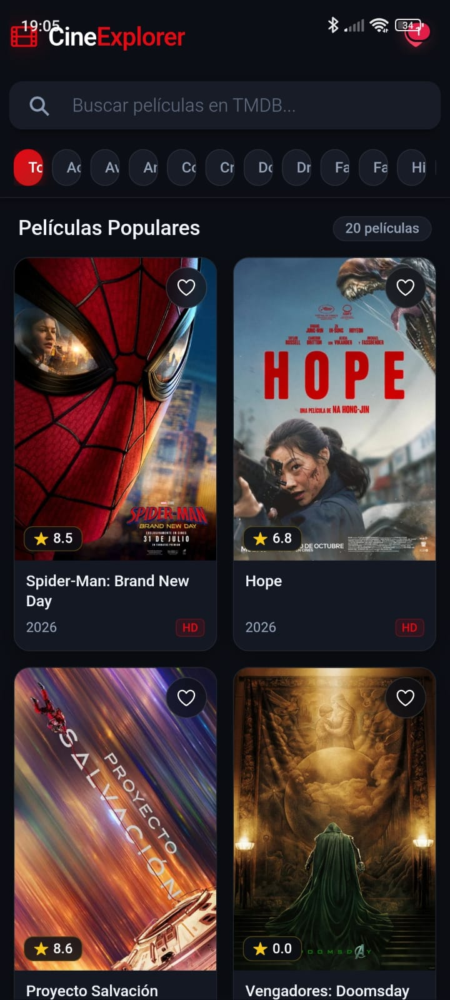
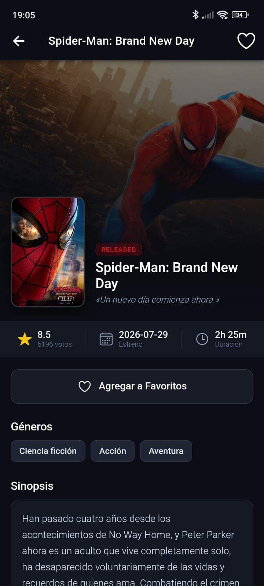
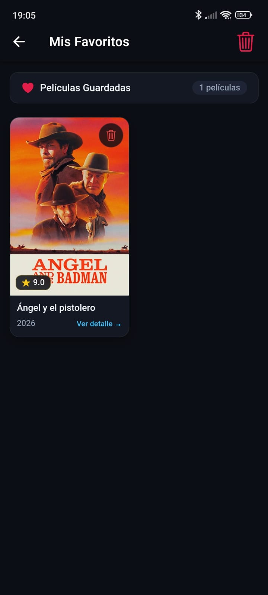
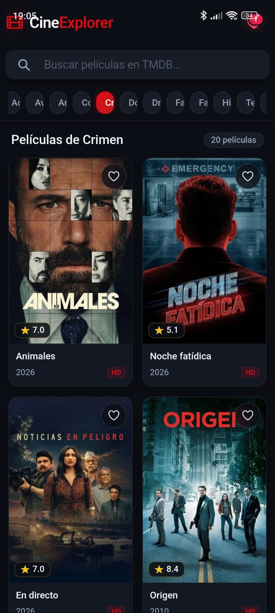

# CineExplorer

Aplicación móvil para explorar películas populares, consultar información detallada y guardar títulos favoritos. CineExplorer obtiene su catálogo de [The Movie Database (TMDB)](https://www.themoviedb.org/) y está construida con Angular, Ionic y Capacitor.

## Tabla de contenidos

- [Resumen y funcionalidades](#resumen-y-funcionalidades)
- [Galería de capturas](#galería-de-capturas)
- [Tecnologías](#tecnologías)
- [Estructura del proyecto](#estructura-del-proyecto)
- [Requisitos previos](#requisitos-previos)
- [Instalación](#instalación)
- [Configuración de TMDB](#configuración-de-tmdb)
- [Uso](#uso)
- [Pruebas](#pruebas)
- [Autores y créditos](#autores-y-créditos)

## Resumen y funcionalidades

CineExplorer reúne en una sola aplicación las herramientas principales para descubrir y organizar películas:

- **Catálogo de películas populares:** consulta el listado proporcionado por TMDB.
- **Búsqueda:** encuentra películas por título, con actualización de resultados mientras se escribe.
- **Filtros por género:** explora las categorías disponibles en TMDB.
- **Paginación progresiva:** carga más resultados al desplazarse por el catálogo.
- **Detalle de película:** muestra información como sinopsis, fecha de estreno, géneros, duración, calificación, presupuesto e ingresos, cuando esos datos están disponibles.
- **Favoritos:** agrega o quita películas y consulta una lista dedicada. Los favoritos se guardan localmente mediante Capacitor Preferences.
- **Interfaz interactiva:** incluye actualización del catálogo mediante gesto de refresco, indicadores de carga, mensajes de error, notificaciones de acciones y recursos alternativos cuando una imagen no está disponible.
- **Navegación por vistas:** catálogo, detalle y favoritos, con rutas en español.

### Catálogo

Vista principal con películas populares, búsqueda y filtros por género.



### Detalle de película

Información ampliada de una película y acceso a la acción de favoritos.



### Favoritos

Películas guardadas por el usuario y controles para administrarlas.



### Resultado final

Captura general de la aplicación en su estado final.



## Tecnologías

| Tecnología | Uso |
|---|---|
| Angular 22 | Componentes, navegación y lógica de la aplicación |
| Ionic 9 | Componentes e interfaz orientada a aplicaciones móviles |
| Capacitor 8 | Integración y soporte para plataformas móviles |
| TypeScript 6 | Desarrollo con tipado estático |
| SCSS | Estilos de la aplicación |
| RxJS | Flujos reactivos y consumo de datos |
| Ionicons | Iconografía |
| Capacitor Preferences | Persistencia local de favoritos |
| TMDB API | Datos e imágenes de películas |

## Estructura del proyecto

```text
api_explorer/
├── android/                         # Proyecto Android de Capacitor
├── docs/
│   └── screenshot/                  # Capturas de pantalla (añadir imágenes)
├── src/
│   ├── app/
│   │   ├── models/                  # Modelos de películas y respuestas TMDB
│   │   ├── pages/
│   │   │   ├── peliculas/           # Catálogo, búsqueda y filtros
│   │   │   ├── detalle-pelicula/    # Información de una película
│   │   │   └── favoritos/           # Gestión de favoritos
│   │   ├── services/                # Acceso a TMDB y favoritos
│   │   └── app.routes.ts            # Rutas de la aplicación
│   ├── assets/                      # Recursos estáticos
│   ├── environments/                # Configuración de entorno y TMDB
│   ├── theme/                       # Variables de tema Ionic
│   ├── global.scss                  # Estilos globales
│   └── main.ts                      # Punto de entrada
├── capacitor.config.ts              # Configuración de Capacitor
├── ionic.config.json                # Configuración de Ionic
├── package.json                     # Dependencias y comandos
└── angular.json                     # Configuración de Angular
```

## Requisitos previos

- [Node.js](https://nodejs.org/) compatible con Angular 22.
- npm (incluido con Node.js).
- Una cuenta y credencial de API de [TMDB](https://www.themoviedb.org/).
- Para ejecutar la aplicación como app Android: Android Studio y el SDK de Android.

## Instalación

1. Clona el repositorio y entra en su directorio:

   ```bash
   git clone https://github.com/Emialejandra/Api_explorer.git
   cd Api_explorer
   ```

2. Instala las dependencias:

   ```bash
   npm install
   ```

3. Configura las credenciales de TMDB según la sección siguiente.

## Configuración de TMDB

La aplicación necesita una credencial de TMDB para cargar el catálogo. Crea archivos locales de entorno a partir de la plantilla:

```bash
cp src/environments/environment.example.ts src/environments/environment.ts
cp src/environments/environment.example.ts src/environments/environment.prod.ts
```

En ambos archivos, completa uno de estos valores:

- `tmdbApiKey`: API Key v3.
- `tmdbReadAccessToken`: Read Access Token v4 (opcional si ya configuraste la API Key).

La plantilla `src/environments/environment.example.ts` muestra la estructura esperada y se mantiene versionada; los archivos locales `environment.ts` y `environment.prod.ts` están excluidos de Git. Obtén las credenciales desde la sección API de tu cuenta de TMDB y no publiques claves reales en repositorios públicos.

## Uso

Inicia el servidor de desarrollo:

```bash
npm start
```

Abre la URL que indique Angular en la terminal (normalmente `http://localhost:4200`). Desde la aplicación puedes buscar películas, filtrarlas por género, abrir su detalle y administrar tus favoritos.

Para generar una compilación:

```bash
npm run build
```

El proyecto incluye integración con Capacitor y una carpeta Android. Para preparar los recursos web y sincronizarlos con las plataformas configuradas:

```bash
npm run build
npx cap sync
```

## Pruebas

Ejecuta las pruebas configuradas en el proyecto con:

```bash
npm test
```

## Autores y créditos

**Ariel Arias y Emilia Tana**  
Estudiantes de quinto semestre de Desarrollo de Software  
Escuela Politécnica Nacional

Los datos de películas e imágenes son proporcionados por [TMDB](https://www.themoviedb.org/). Este proyecto utiliza la API de TMDB y no está respaldado ni certificado por TMDB.
